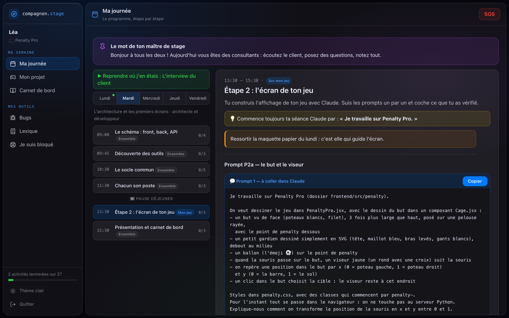
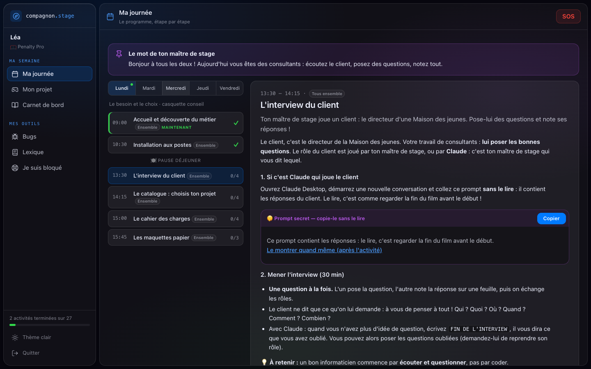
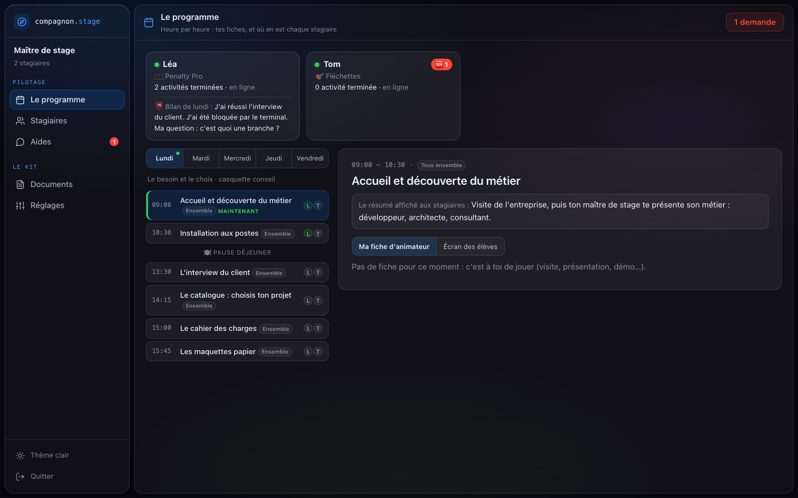
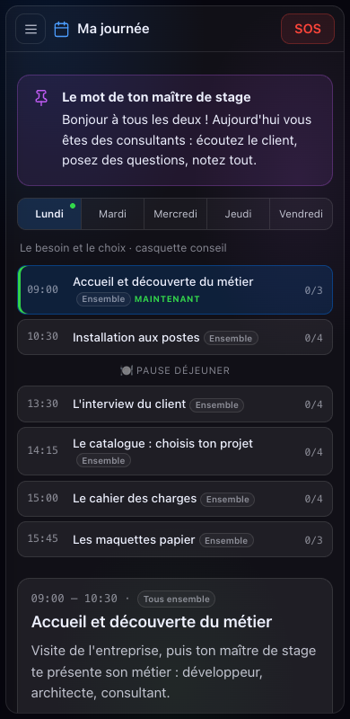

# 🧭 Le compagnon de stage

Une petite application web qui met le kit en ligne pendant la semaine :

- **Ton écran (animateur)** : le programme heure par heure avec les fiches complètes (prompts, conseils, « Si ça coince »),
  l'avancement de chaque élève, les demandes d'aide, les carnets de bord, tous les documents du kit,
  et le `CLAUDE.md` du projet déjà rempli avec les jeux choisis.
- **L'écran de chaque élève** : sa journée, avec pour chaque activité les prompts prêts à copier **adaptés à SON jeu**,
  les cases « Ce qu'on vérifie » à cocher, son carnet de bord (enregistré tout seul, imprimable), le catalogue pour choisir
  son projet, la chasse aux bugs, le lexique, la page **« Je suis bloqué »** et un bouton **SOS**.
- **Des élèves autonomes** : chaque activité, même celles que tu animes, affiche un pas-à-pas écrit pour eux ; ils enchaînent
  seuls (« Reprendre où j'en étais », « Activité suivante ») et se dépannent avec « Je suis bloqué ». Toi, tu vois qui est en ligne,
  où en est chacun, et leur bilan du soir. Voir `guides/autonomie-des-eleves.md`.

Les fichiers `.md` du kit restent **la seule source** : l'application les lit et les découpe. Si tu modifies un prompt
dans `prompts/…`, il apparaît dans l'appli après un redéploiement.

| Écran élève (une étape de son jeu) | Écran élève (un moment « ensemble » : l'interview) | Écran animateur |
|---|---|---|
|  |  |  |

Sur téléphone, la navigation devient un tiroir : 

L'interface reprend le style de NomaUBL et Liberty Next (verre dépoli sombre, navigation à gauche, bandeau de page),
avec un thème clair au choix (bouton en bas de la navigation). Pas de librairie d'interface : tout est dans `frontend/src/index.css`.

---

## Ce que l'appli fait pour toi pendant la semaine

| Moment | Ce qui se passe |
|---|---|
| **Avant** | Tu crées les deux comptes (prénom seulement) → un code à 6 caractères chacun. Tu imprimes les **fiches d'accès**. |
| **Lundi 14 h** | Chaque élève choisit son jeu dans l'onglet « Mon projet ». S'ils prennent le même : formule « deux agences concurrentes » automatique (dossiers `flechettes_lea` / `flechettes_tom`, remplacés dans tous leurs prompts). Le prompt du cahier des charges et celui du socle (mardi) se remplissent tout seuls avec leurs choix. |
| **Mardi → jeudi** | Chaque élève suit les prompts de SON jeu, coche ce qu'il a vérifié et marque l'activité « terminée ». Toi, tu vois l'avancement d'un coup d'œil (initiales vertes / orange sur la frise). |
| **Une demande d'aide** | Le bouton SOS demande d'abord à l'élève s'il a relu l'erreur et demandé à Claude (le réflexe du métier). Ta page affiche un badge rouge (et le titre de l'onglet du navigateur : « (1) 🆘 ») ; tu réponds en un clic avec une réponse rapide, ou tu y vas. |
| **Un élève bloqué** | La page « Je suis bloqué » lui donne l'échelle du dépannage (lire l'erreur → Claude → l'autre stagiaire → les pannes courantes → revenir en arrière → t'écrire), avec les prompts de secours prêts à copier. |
| **Les moments « ensemble »** | Les élèves ont aussi leur pas-à-pas (le bouton « Écran des élèves » te le montre) : ils savent quoi faire sans attendre ta consigne. Ta fiche, avec tes notes, reste sur ton écran. |
| **Jeudi 11 h** | 🎭 La demande du client reste **cachée** chez les élèves jusqu'à ce que tu cliques « Déclencher pour tous », après avoir joué la scène. Ils ne voient que les paroles du client et les prompts, pas tes notes (« Laisse l'élève réagir… »). |
| **Jeudi après-midi** | La chasse aux bugs : le testeur décrit le bug (fait / obtenu / attendu), le développeur le reçoit dans son onglet et le coche « corrigé ». |
| **Chaque soir** | Le carnet de bord en ligne (les questions de `fiches/carnet-de-bord.md`), et le **bilan du jour** en trois lignes à la fin de la dernière activité. Le bilan s'affiche sur ton tableau de bord ; le carnet se lit depuis « Stagiaires → Voir son carnet ». |
| **Vendredi** | Bouton « Imprimer » du carnet (pour le rapport de stage). Puis, après le stage : **Réglages → Tout effacer**. |

Le jour courant est calculé à partir de la **date du lundi** (Réglages). Pour la répétition générale, ou si le programme
a pris du retard, « Forcer le jour » affiche le jour de ton choix chez tout le monde.

---

## Essayer en local (5 minutes)

**Le plus simple**, depuis la racine du kit (macOS ou Linux) :

```bash
./lancer.sh                    # → http://127.0.0.1:8000, mot de passe animateur : « animateur »
./lancer.sh stop               # arrête ce qui tourne encore (si le script dit qu'un port est déjà utilisé)
```

Une seule adresse pour tout : le menu de gauche (élèves et animateur) a une entrée **« La salle de jeux »** qui affiche
les 4 jeux d'exemple de la solution **dans le compagnon**, avec ses couleurs. C'est là que les élèves jouent le lundi avant de choisir.
En coulisses, le compagnon lance lui-même le serveur des jeux à côté de lui et lui transmet leurs questions (`backend/app/salle.py`) ;
la solution de référence n'est pas modifiée, son habillage est dans `frontend/public/jeux-theme.css`.
C'est pareil sur la VM : l'image Docker contient les jeux, il n'y a rien de plus à déployer.

Le script crée l'environnement virtuel Python (`backend/.venv`), installe ce qui manque et reconstruit les sites si un fichier a changé.
Avec `--reseau`, les postes des élèves peuvent s'y connecter (il faut alors choisir un mot de passe :
`ANIMATEUR_MOT_DE_PASSE='…' ./lancer.sh --reseau`). Ctrl+C arrête tout.

**À la main**, pour comprendre ce que fait le script :

```bash
# 1) Le site React (une seule fois, puis à chaque modification du site)
cd compagnon-de-stage/frontend
npm install
npm run build              # → crée backend/dist
# (les jeux d'exemple, pour « La salle de jeux » : dans solution/salle-de-jeux/frontend,
#  npm install puis npx vite build --base=/jeux/ --outDir ../../../compagnon-de-stage/backend/dist-jeux --emptyOutDir)

# 2) Le serveur
cd ../backend
python -m venv .venv && source .venv/bin/activate      # Windows : .venv\Scripts\activate
pip install -e ".[dev]"
COMPAGNON_DEV=1 fastapi dev    # mot de passe animateur en mode dev : « animateur »
```

Ouvre http://127.0.0.1:8000 : « Maître de stage » → `animateur`. Crée deux stagiaires, puis ouvre une fenêtre
de navigation privée pour te connecter avec un des codes : tu vois les deux côtés.

Pour travailler sur le site avec rechargement automatique : `npm run dev` dans `frontend/` (http://localhost:5173,
les appels `/api` partent vers le serveur Python).

Tests : `pytest` dans `backend/` (21 tests, dont un qui vérifie que **chaque activité trouve bien son morceau
de fichier .md pour chacun des 4 jeux**, et un autre que chaque activité « ensemble » a son guide pour les élèves :
si tu renommes un titre « ## … » dans un fichier du kit, ils te le diront).

---

## Mettre en ligne sur ta VM OCI

Pourquoi pas FastAPI Cloud ? L'appli enregistre les carnets dans un fichier (SQLite). Sur FastAPI Cloud, rien ne garantit
que ce fichier survive à un redémarrage ou à un redéploiement. Sur ta VM, il vit dans un **volume Docker** : il survit
aux redémarrages et aux mises à jour.

L'architecture : `Internet → Caddy (HTTPS automatique) → le compagnon (FastAPI + le site React) → SQLite (volume)`.

### 1. Le nom de domaine

Chez ton registrar, un enregistrement **A** : `stage.ton-domaine.fr → IP publique de la VM`.
Vérifie : `dig +short stage.ton-domaine.fr`.

### 2. Ouvrir les ports 80 et 443 (les deux pièges OCI)

- **Console OCI** → ton VCN → *Security List* (ou NSG) → règles d'entrée TCP **80** et **443** depuis `0.0.0.0/0`.
- **Sur la VM** (images Ubuntu d'Oracle : iptables bloque tout sauf SSH) :
  ```bash
  sudo iptables -I INPUT 6 -m state --state NEW -p tcp --dport 80 -j ACCEPT
  sudo iptables -I INPUT 6 -m state --state NEW -p tcp --dport 443 -j ACCEPT
  sudo netfilter-persistent save
  ```

Si la salle de jeux tourne déjà sur la même VM avec son propre Caddy, voir « Une seule VM pour les deux » plus bas.

### 3. Docker

```bash
curl -fsSL https://get.docker.com | sudo sh
sudo usermod -aG docker $USER   # puis se déconnecter / reconnecter
```

### 4. Le kit sur la VM, et les secrets

```bash
git clone <ton-dépôt-du-kit> kit-stage && cd kit-stage      # ou : scp -r du dossier du kit
cp compagnon-de-stage/deploy/.env.exemple compagnon-de-stage/deploy/.env
nano compagnon-de-stage/deploy/.env
```

Dans `.env` : ton domaine, et un **mot de passe animateur long** (une phrase de 4-5 mots, par exemple).
Ce fichier n'est jamais commité (il est dans `.gitignore`).

### 5. Lancer

```bash
docker compose -f compagnon-de-stage/deploy/docker-compose.yml up -d --build
docker compose -f compagnon-de-stage/deploy/docker-compose.yml logs -f      # Ctrl+C pour quitter
```

Au premier lancement, Caddy obtient le certificat HTTPS (quelques secondes). Ouvre `https://stage.ton-domaine.fr`.

### Mettre à jour (un prompt modifié, une nouvelle version)

```bash
git pull
docker compose -f compagnon-de-stage/deploy/docker-compose.yml up -d --build
```

Les carnets et les comptes sont conservés (ils sont dans le volume `donnees`).

### Sauvegarder les carnets (conseillé chaque soir)

```bash
docker compose -f compagnon-de-stage/deploy/docker-compose.yml exec compagnon \
  python -c "import sqlite3; s=sqlite3.connect('/donnees/compagnon.db'); s.backup(sqlite3.connect('/donnees/sauvegarde.db'))"
docker compose -f compagnon-de-stage/deploy/docker-compose.yml cp compagnon:/donnees/sauvegarde.db ./sauvegarde-$(date +%F).db
```

### Une seule VM pour les deux (compagnon + salle de jeux)

Un seul Caddy suffit : ajoute un bloc par domaine dans le même Caddyfile, et mets les deux services dans le même
`docker-compose.yml` (ou sur le même réseau Docker) :

```
stage.ton-domaine.fr {
	reverse_proxy compagnon:8000
}
jeux.ton-domaine.fr {
	reverse_proxy salle-de-jeux:8000
}
```

### À la fin du stage

1. Imprime les carnets (Stagiaires → Voir son carnet → Imprimer), ou laisse les élèves le faire vendredi.
2. **Réglages → Tout effacer** (écrire EFFACER).
3. Si tu n'en as plus besoin : `docker compose -f compagnon-de-stage/deploy/docker-compose.yml down -v`
   (le `-v` supprime aussi le volume et donc la base).

---

## Données et sécurité

- **Ce qui est enregistré :** le prénom, le jeu choisi, les cases cochées, les réponses du carnet, les bilans du jour,
  les demandes d'aide, les bugs, et l'heure à laquelle l'écran de l'élève a parlé au serveur pour la dernière fois
  (pour le point « en ligne »). Pas de nom de famille, pas d'e-mail, pas d'adresse IP en base. Ce sont des données de mineurs :
  garde-les le temps du stage seulement, puis efface tout.
- **Les élèves** se connectent avec un code à 6 caractères. Si un code a circulé : « Nouveau code » (l'ancien et les
  sessions ouvertes ne marchent plus). Les essais de connexion en rafale sont freinés.
- **Le mot de passe animateur** vient de la variable d'environnement `ANIMATEUR_MOT_DE_PASSE` (jamais dans le code).
  Sans elle, la connexion animateur est refusée (sauf en mode dev local).
- **HTTPS** par Caddy, en-têtes de sécurité, conteneur qui tourne sans les droits root.
- Un élève ne peut lire et modifier que **ses** données ; les routes `/api/animateur/…` exigent le jeton animateur.

---

## Comment c'est construit (si un élève demande !)

```
compagnon-de-stage/
  backend/                  Python + FastAPI
    app/programme.py        LA STRUCTURE de la semaine : jour, heure, et quel morceau de quel fichier .md
    app/contenu.py          lit les .md, les découpe (« de tel titre ## à tel titre ## »), les transforme en blocs
                            (texte, prompt à copier, cases à cocher) et les adapte à l'élève
    app/services.py         le jour courant, l'avancement, le dossier de chaque version, le guide des élèves
    app/routes.py           l'API : connexion, programme, espace élève (/api/moi), espace animateur (/api/animateur)
    app/salle.py            la salle de jeux d'exemple : lance le serveur des jeux et l'affiche dans le compagnon
    app/base.py             la base SQLite
    tests/                  pytest
  frontend/                 React + Vite
    src/Coquille.jsx        la navigation à gauche et le bandeau de page, communs aux deux espaces
    src/index.css           tout le style (les couleurs sont des variables en haut du fichier)
    src/stagiaire/          Ma journée, Mon projet, Carnet, Bugs, Lexique, Je suis bloqué, la fenêtre d'aide
    src/animateur/          Le programme, Stagiaires, Aides, Documents, Réglages
  Dockerfile                une image : le site construit + le serveur + les fichiers .md du kit + les 4 jeux d'exemple
  deploy/                   docker-compose + Caddy pour la VM OCI
```

Pour changer l'horaire ou l'ordre des activités : `backend/app/programme.py` (une ligne par activité).
Pour changer un texte, un prompt ou une question du carnet : directement dans les fichiers `.md` du kit.
Pour changer le pas-à-pas des élèves et la page « Je suis bloqué » : `autonomie/parcours-eleves.md` et `autonomie/depannage.md`.
